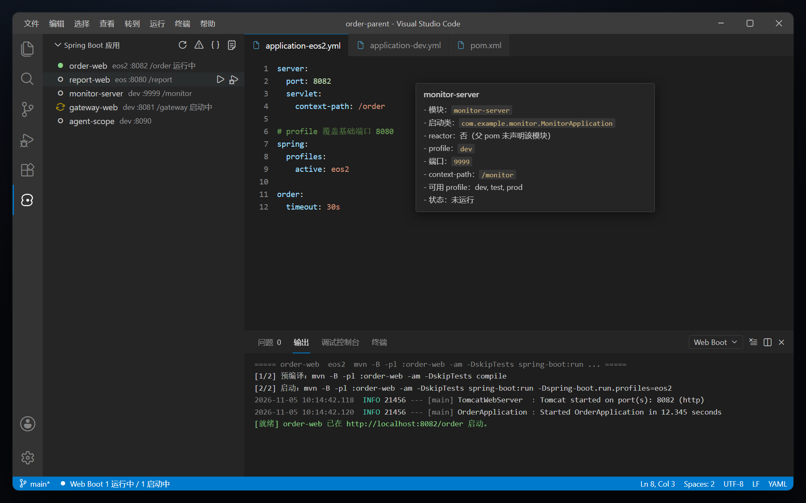
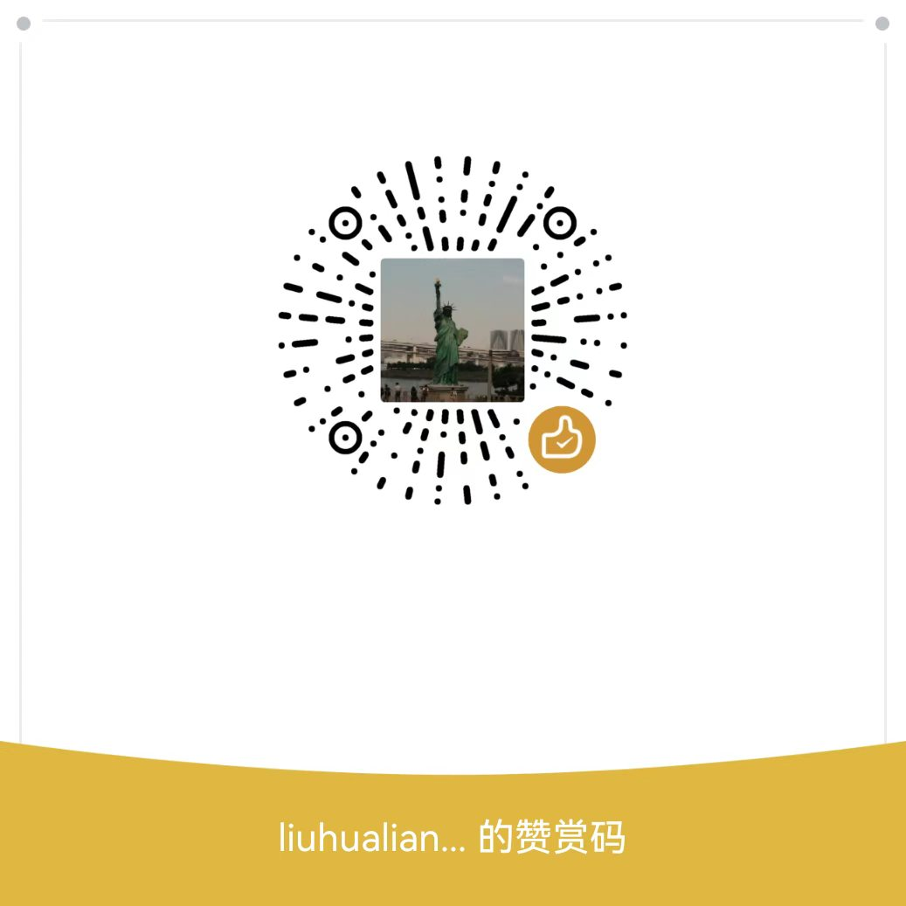

# Web Boot Runner

Run, stop, and debug Spring Boot applications in multi-module Maven workspaces — with reactor-aware commands, profile-aware ports, and port-conflict checks.

[](https://marketplace.visualstudio.com/items?itemName=liuhualiang.web-boot-runner)
[](https://marketplace.visualstudio.com/items?itemName=liuhualiang.web-boot-runner)
[](https://marketplace.visualstudio.com/items?itemName=liuhualiang.web-boot-runner)
[](https://github.com/eppen/vscode-web-boot/blob/main/LICENSE)

**[English](#english) · [简体中文](#简体中文)**



---

## English

### Why this extension

Multi-module Spring Boot repositories usually have two recurring problems:

- **Modules outside the Maven reactor.** A module can be commented out in the parent POM, or never declared at all. `mvn -pl :module` then fails with `Could not find the selected project in the reactor`.
- **Ports hidden behind profiles.** A single module may have many `application-*.yml` files that override `server.port`, while several web modules default to the same port (commonly 8080).

Web Boot Runner detects both cases and handles them automatically.

### Features

- **Application tree** in the activity bar, showing live status, profile, port, and context path.
- **Manual groups** — create groups in the tree, drag apps in or out, and start/debug/stop an entire group; group nodes summarize port conflicts among their members.
- **One-click run and restart** via `mvn spring-boot:run`, with an optional pre-build step (`compile` by default).
- **Reactor-aware commands** — uses `-pl :artifact` (`-am` optional via `webBoot.buildDependencies`) inside the reactor and falls back to `-f <module>/pom.xml` outside it.
- **Profile-aware ports** — merges the base config with each `application-<profile>.*` file to compute the effective port and context path.
- **Port-conflict detection** — scans all apps before launch and offers to pick a free port, use the occupied one, or cancel.
- **Debug with auto-attach** — starts the app with JDWP and attaches after Spring Boot reports ready.
- **launch.json generation** — writes `type: java` configurations for developers who prefer pressing F5.
- **Readiness detection** — parses the run log for `Started ... in ... seconds`, the actual port, context path, and common failure messages.
- **Runtime monitoring** — after startup, refreshes JVM heap/GC (via `jstat`) and Tomcat HTTP status every 5 seconds in the tree and tooltip; shows Tomcat thread-pool metrics when Actuator is available.
- **Runtime coverage (JaCoCo)** — optionally attaches a JaCoCo agent to `spring-boot:run` (tcpserver mode); dumps execution data before the process is killed, merges it across runs, and generates HTML + XML reports with line/branch/class rates shown in the tree and tooltip.
- **Process-tree stop** — uses `taskkill /T /F` on Windows, so no orphan Java process keeps the port.
- **Survives a window reload** — runtime state is persisted in `workspaceState`, so after reloading or restarting the window the extension re-adopts the Spring Boot processes left from the previous session (status, port, context path, profile, last command), and closing the window no longer kills running apps.
- **Copy launch command** — copies the exact Maven command for use in any terminal.
- **Multi-language UI** — English, Simplified Chinese, and Japanese; follows the VS Code display language by default and can be pinned with `webBoot.language`.

### Requirements

- VS Code 1.75 or newer (Cursor works as well).
- Java and Maven available to the extension (`mvn` on `PATH`, or configure `webBoot.mavenCommand`).
- A workspace whose root contains the Maven `pom.xml`.
- The extension UI is currently in Chinese.

### Getting started

1. Install **Web Boot Runner** from the Marketplace, or sideload the VSIX:

   ```bash
   code --install-extension web-boot-runner-0.1.5.vsix
   cursor --install-extension web-boot-runner-0.1.5.vsix
   ```

2. Open the root of your multi-module project.
3. Click the **Web Boot** icon in the activity bar.

Example application list:

```text
order-web              dev    :8080   /order
report-web             dev    :8080   /report
monitor-server         dev    :9999   /monitor
```

- Click a stopped app to run it; click a running app to open it in the browser.
- Hover a node for inline Run / Debug / Edit or Open / Stop / Restart / Edit buttons.
- Right-click for profile selection, port override, profile/port/main-class/`-am`/coverage editing, moving apps between groups, command copy, **Reload Resources** on a running app (`mvn process-resources`), and **Sample Coverage** / **Open Coverage Report** when coverage is enabled.
- Drag apps onto a group (or onto the virtual "Ungrouped" bucket) to organize them; group nodes expose start/debug/stop for the whole group.
- Toolbar buttons: refresh, check port conflicts, generate `launch.json`, show output, create group.

### Commands

| Command | Description |
| --- | --- |
| `Web Boot: 刷新应用列表` (Refresh) | Rescan POMs and Spring configuration files |
| `Web Boot: 运行` (Run) | Start with the remembered profile, port, and main class |
| `Web Boot: 选择 Profile 运行...` (Run with Profile) | Pick a profile from the module's `application-*.yml` files; clears the remembered port so the profile's own port applies |
| `Web Boot: 指定端口运行...` (Run with Port) | Override the port and remember it |
| `Web Boot: 编辑 Profile / 端口 / 主类 / -am / 覆盖率...` (Edit) | Edit the remembered profile, port, main class, `-am` switch, and coverage switch without launching; an empty port falls back to the config file, `-am` and coverage can follow the global setting or override it per app, and changes apply on the next start |
| `Web Boot: 新建分组...` (Create Group) | Create a manual group; drag apps into it afterwards |
| `Web Boot: 重命名分组...` / `删除分组` (Rename / Delete Group) | Rename or delete a group; deleting only ungroups apps |
| `Web Boot: 移动到分组...` (Move to Group) | Move an app into a group or back to "Ungrouped" |
| `Web Boot: 启动整组` / `调试整组` / `停止整组` (Start / Debug / Stop Group) | Start (or debug-start with JDWP) the group's stopped apps in order, or stop its running apps |
| `Web Boot: 调试运行（自动 attach）` (Debug) | Start with JDWP and attach automatically after startup |
| `Web Boot: 停止` (Stop) | End the whole process tree with `taskkill /T /F` |
| `Web Boot: 重启` (Restart) | Stop, then start again with the remembered profile / port / main class / `-am`; a debug run is restarted in debug mode |
| `Web Boot: 重新加载资源` (Reload Resources) | Run `mvn process-resources` against a running app to copy resource changes into `target/classes`; does not restart the process, and Stop can interrupt it |
| `Web Boot: 采样覆盖率` (Sample Coverage) | While running: dump the latest execution data, then generate the report; while stopped: regenerate the report from the accumulated exec. Requires the current run to have the JaCoCo agent attached |
| `Web Boot: 打开覆盖率报告` (Open Coverage Report) | Open the app's latest HTML report (`index.html`) in the browser |
| `Web Boot: 在浏览器中打开` (Open) | Build the URL from port and context path |
| `Web Boot: 复制启动命令` (Copy Command) | Copy the Maven command to the clipboard |
| `Web Boot: 检查端口冲突` (Check Port Conflicts) | Print every app's effective port and conflict groups in the output channel |
| `Web Boot: 释放端口（结束占用进程）...` (Release Port) | Find and kill the process listening on a given port: shows PID, process name, and command line before confirming; if the port belongs to an app managed by this extension, it stops that app instead (keeping the coverage dump) |
| `Web Boot: 生成 launch.json` (Generate launch.json) | Write `type: java` entries to `.vscode/launch.json`, replacing only entries prefixed with `Web Boot: ` |
| `Web Boot: 显示输出窗口` (Show Output) | Open the Web Boot output channel |

### Settings

| Setting | Default | Description |
| --- | --- | --- |
| `webBoot.mavenCommand` | `mvn` | Maven executable |
| `webBoot.preBuild` | `compile` | Pre-build goal: `none` / `compile` / `package` / `install` |
| `webBoot.buildDependencies` | `true` | Append `-am` inside the reactor (also build dependency modules). Disable to build only the target module; its dependencies must already be installed locally |
| `webBoot.monitor` | `true` | Sample JVM heap/GC and Tomcat HTTP status every 5 seconds while running; shown in the tree and tooltip |
| `webBoot.debugPort` | `5005` | JDWP port; automatically incremented when occupied |
| `webBoot.runner` | `outputChannel` | `outputChannel` enables readiness detection and precise stop; `terminal` only sends the command to a terminal |
| `webBoot.autoAttach` | `true` | Attach automatically when debugging |
| `webBoot.autoOpen` | `false` | Open the browser automatically when the app is ready |
| `webBoot.javaHome` | empty | Override `JAVA_HOME` for launched processes |
| `webBoot.extraArgs` | `[]` | Extra JVM arguments, for example `-Xmx2g` |
| `webBoot.coverage` | `false` | Attach a JaCoCo agent (tcpserver mode) to `spring-boot:run`; dumps execution data before the process is killed and generates HTML + XML reports. Not available in terminal mode |
| `webBoot.coveragePort` | `6300` | JaCoCo agent tcpserver port; automatically incremented when occupied |
| `webBoot.coverageJacocoVersion` | `0.8.13` | JaCoCo version (agent and CLI); downloaded via `mvn dependency:get` on first use and cached under `.vscode/web-boot/jacoco/` |
| `webBoot.language` | `auto` | UI language: `auto` (follow the VS Code display language), `zh-cn`, `en`, or `ja` |

Per-app preferences (profile, port, main class, `buildDependencies`, `coverage`) and manual groups are stored in `.vscode/web-boot.json` inside the workspace. A per-app `buildDependencies` or `coverage` value overrides the global setting for that app only.

### How it works

- Scans `**/src/main/java/**/*Application.java` for classes annotated with `@SpringBootApplication`.
- Parses POMs with XML comments stripped to build the reactor model; modules outside the reactor use the `-f` form.
- Deep-merges the base `application.*` file with each `application-<profile>.*` file to resolve the effective `server.port` and `server.servlet.context-path`.
- Launches `mvn spring-boot:run` and watches the output for `Started ... in ... seconds`; the actual port reported by Tomcat or Netty takes precedence over configuration.
- While running, locates the Java process via `jps -l` (the Maven pid is a shell, not the JVM), reads heap and GC with `jstat -gc`, probes the app with HTTP `HEAD`, and optionally reads Tomcat thread-pool metrics from Actuator.
- With coverage enabled, appends a JaCoCo `-javaagent` (tcpserver mode) to `spring-boot:run`; on stop or manual sampling it first runs `jacococli dump` against the agent port, merges the exec with previous runs, and generates HTML + XML reports with `jacococli report`.
- Stops the entire process tree, preventing orphan Java processes from holding the port.
- Persists a runtime snapshot (app → pid / port / last command) into `workspaceState` with a 400 ms debounce. Closing the window only saves the snapshot; on activation the extension verifies each pid and re-adopts the survivors, polling them every 15 seconds and flipping them back to stopped when they disappear.

### Notes and limitations

- **Terminal mode does not detect readiness.** With `webBoot.runner = terminal`, the node is marked running immediately, auto-attach is unavailable, and Stop does not end the process in the terminal.
- **Output encoding is detected per line.** Each line's bytes are decoded as UTF-8 when valid and as GBK otherwise, so Chinese logs from JDK 8 apps on Windows (which default to `file.encoding=GBK`) display correctly without changing the system code page or switching to terminal mode. Only if the host lacks a GBK decoder (ICU missing) does it fall back to plain UTF-8, where Chinese text may still be garbled; readiness detection relies on ASCII log lines and is unaffected either way.
- **Modules may need a different JDK or Maven.** For example, a Boot 3.x module may require JDK 17 and Maven 3.6.3+ while the rest of the repository uses older versions. Point `webBoot.javaHome` at the required JDK and use a matching Maven.
- **Generated `launch.json` entries are not guaranteed to work.** For modules outside the reactor, the VS Code Java language server may not have imported the project. Use this extension's Maven path for those modules.
- **Monitoring needs JDK tools.** `jps` / `jstat` ship with the JDK; with a JRE only, JVM metrics show as unavailable while the Tomcat HTTP status still works.
- **Actuator metrics use the default path.** A custom `management.server.port` or `management.endpoints.web.base-path` disables the thread-pool display; HTTP probing is unaffected.
- **Terminal mode has no monitoring.** With `webBoot.runner = terminal`, the Java process is unknown and no JVM / Tomcat metrics are collected.
- **Coverage needs compiled classes and is unavailable in terminal mode.** The dump/report steps run `java -jar jacococli`; if `target/classes` is missing, coverage is skipped for that run. Only the module's own classes are measured (dependency modules are not included). Coverage preparation failures degrade gracefully: the app still starts without the agent.
- **Adopted apps have no log replay.** After a window reload the extension only knows the pid of the process left from the previous session; earlier output is gone, so restart the app to get logs. If the process is killed outside the editor, the node flips to stopped within 15 seconds.

### Development

Building from source, the self-check scripts, and the implementation notes live in [DEVELOPMENT.md](https://github.com/eppen/vscode-web-boot/blob/main/DEVELOPMENT.md) (Chinese).

### Support

If this extension saved you some time, you can optionally buy the author a coffee via WeChat Pay. Donations are entirely voluntary: they unlock nothing and imply no support commitment.

<p align="center">
  <a href="media/donate-wechat.png"></a>
</p>

<p align="center">
  <a href="media/donate-wechat.png"></a>
</p>

<sub>Ad slot — this page keeps one clearly-labelled sponsor slot, for tools and services a Spring Boot / VS Code developer would actually use. To take it, reach the author through the WeChat QR code above and mention AD. Ads are always marked as ads, carry a plain https link and a static PNG at most, contain no tracking pixels or affiliate links, and never change how this extension behaves.</sub>

### License

[MIT](https://github.com/eppen/vscode-web-boot/blob/main/LICENSE) © 2026 eppen

---

## 简体中文

### 为什么需要它

多模块 Spring Boot 仓库通常有两个反复出现的问题：

- **模块不在 Maven reactor 内。** 模块可能在父 POM 中被注释掉，或从未声明。此时 `mvn -pl :module` 会报 `Could not find the selected project in the reactor`。
- **端口藏在 profile 里。** 一个模块可能有很多 `application-*.yml` 覆盖 `server.port`，同时多个 Web 模块默认使用同一个端口（通常是 8080）。

Web Boot Runner 会自动识别并处理这两种情况。

### 功能

- **应用树**：活动栏中的列表，直接显示运行状态、profile、端口与 context-path。
- **手动分组**：在树中新建分组，拖拽应用归类，可整组启动 / 调试 / 停止；分组标题汇总组内端口冲突。
- **一键启动与重启**：通过 `mvn spring-boot:run` 启动，可选预编译步骤（默认 `compile`）。
- **reactor 感知**：reactor 内使用 `-pl :artifact`（`-am` 由 `webBoot.buildDependencies` 控制），reactor 外自动降级为 `-f <模块>/pom.xml`。
- **profile 端口计算**：将基础配置与每个 `application-<profile>.*` 深合并，算出该 profile 的生效端口与 context-path。
- **端口冲突检测**：启动前检查全部应用，可结束占用端口的进程、自动换端口、仍用该端口或取消；占用者是本扩展管理的应用时直接停止它。
- **调试自动 attach**：以 JDWP 启动，Spring Boot 就绪后自动连接调试器。
- **生成 launch.json**：为习惯按 F5 的开发者写入 `type: java` 配置。
- **就绪检测**：解析启动日志中的 `Started ... in ... seconds`、实际端口、context-path 与常见失败信息。
- **运行期监控**：启动后每 5 秒刷新 JVM 堆/GC（`jstat`）与 Tomcat HTTP 状态，显示在树节点与悬浮提示；应用暴露 Actuator 时还会显示 Tomcat 线程池。
- **运行时覆盖率（JaCoCo）**：可选给 `spring-boot:run` 挂 JaCoCo agent（tcpserver 模式），停止 / 采样时先 dump 执行数据再结束进程，多次运行累积合并后生成 HTML + XML 报告，行 / 分支 / 类命中率显示在树节点与悬浮提示。
- **按进程树停止**：Windows 下使用 `taskkill /T /F`，避免 Java 子进程残留占用端口。
- **窗口重载后接管**：运行期状态写入 `workspaceState`，重载 / 重启窗口后自动接管上一会话遗留的进程，树节点恢复为运行中（状态、端口、context-path、profile、上次命令一并还原）；关闭窗口不再顺带结束应用。
- **复制启动命令**：把实际执行的 Maven 命令复制到剪贴板，可贴进任意终端。
- **多语言界面**：简体中文 / 英文 / 日文，默认跟随 VS Code 显示语言，可用 `webBoot.language` 固定。
- **中 / 日 / 英 三语界面**：默认跟随 VS Code 显示语言，也可用 `webBoot.language` 固定为 `zh-cn` / `en` / `ja`。

### 环境要求

- VS Code 1.75 或更高版本（Cursor 同样可用）。
- 扩展可访问 Java 与 Maven（`mvn` 在 `PATH` 中，或配置 `webBoot.mavenCommand`）。
- 工作区根目录包含 Maven 的 `pom.xml`。
- 界面支持简体中文 / 英文 / 日文，默认跟随 VS Code 的显示语言。

### 快速开始

1. 从插件市场安装 **Web Boot Runner**，或离线安装 VSIX：

   ```bash
   code --install-extension web-boot-runner-0.1.5.vsix
   ```

2. 打开多模块项目的根目录。
3. 点击活动栏中的 **Web Boot** 图标。

应用列表示意：

```text
order-web              dev    :8080   /order
report-web             dev    :8080   /report
monitor-server         dev    :9999   /monitor
```

- 点击未运行的节点启动应用；点击运行中的节点在浏览器打开。
- 悬浮节点出现内联按钮：启动 / 调试 / 编辑，或打开 / 停止 / 重启 / 编辑。
- 右键菜单可选择 Profile、指定端口、编辑 Profile / 端口 / 主类 / `-am`、移动到分组、复制启动命令；运行中的应用还可「重新加载资源」（`mvn process-resources`）。
- 把应用拖到分组（或虚拟的「未分组」桶）即可归类；分组节点可启动 / 调试 / 停止整组。
- 标题栏按钮：刷新、检查端口冲突、生成 `launch.json`、显示输出、新建分组。

### 命令

| 命令 | 说明 |
| --- | --- |
| `Web Boot: 刷新应用列表` | 重新扫描 POM 与 Spring 配置文件 |
| `Web Boot: 运行` | 用记住的 profile、端口与主类启动 |
| `Web Boot: 选择 Profile 运行...` | 从模块的 `application-*.yml` 中选择 profile；切换时会清掉记住的端口，让新 profile 的配置生效 |
| `Web Boot: 指定端口运行...` | 临时覆盖端口并记住 |
| `Web Boot: 编辑 Profile / 端口 / 主类 / -am / 覆盖率...` | 不启动进程，逐项修改记住的 profile、端口、主类、`-am` 开关与覆盖率开关；端口留空则回到配置文件的值，主类可选扫描候选或手动输入，`-am` 与覆盖率均可选跟随全局或按应用覆盖，运行中的实例重启后生效 |
| `Web Boot: 新建分组...` | 新建手动分组，之后可拖拽应用加入 |
| `Web Boot: 重命名分组...` / `删除分组` | 重命名或删除分组；删除只解除归类，不删除应用 |
| `Web Boot: 移动到分组...` | 把应用移入分组或移回「未分组」 |
| `Web Boot: 启动整组` / `调试整组` / `停止整组` | 按顺序启动（或带 JDWP 调试启动）组内未运行的应用，或停止组内运行中的应用 |
| `Web Boot: 调试运行（自动 attach）` | 以 JDWP 启动，就绪后自动 attach |
| `Web Boot: 停止` | 用 `taskkill /T /F` 结束整棵进程树 |
| `Web Boot: 重启` | 停止后按记住的 profile / 端口 / 主类 / `-am` 重新启动；调试运行的应用仍以调试方式重启 |
| `Web Boot: 重新加载资源` | 对运行中的应用执行 `mvn process-resources`，把资源改动拷入 `target/classes`；不重启进程，执行中点「停止」可打断 |
| `Web Boot: 采样覆盖率` | 运行中先 dump 最新执行数据再出报告；已停止时直接用累积的 exec 重新出报告。需要本次启动挂了 JaCoCo agent |
| `Web Boot: 打开覆盖率报告` | 在浏览器中打开该应用最近一次生成的 HTML 报告（`index.html`） |
| `Web Boot: 在浏览器中打开` | 按端口与 context-path 拼接地址 |
| `Web Boot: 复制启动命令` | 将 Maven 命令复制到剪贴板 |
| `Web Boot: 检查端口冲突` | 在输出通道打印每个应用的有效端口与冲突组 |
| `Web Boot: 生成 launch.json` | 写入 `type: java` 配置，只替换以 `Web Boot: ` 开头的条目 |
| `Web Boot: 显示输出窗口` | 打开 Web Boot 输出通道 |

### 配置

| 配置项 | 默认值 | 说明 |
| --- | --- | --- |
| `webBoot.mavenCommand` | `mvn` | Maven 可执行文件 |
| `webBoot.preBuild` | `compile` | 启动前目标：`none` / `compile` / `package` / `install` |
| `webBoot.buildDependencies` | `true` | reactor 内是否追加 `-am`（同时构建依赖模块）。关闭后只构建目标模块，依赖需已安装到本地仓库 |
| `webBoot.monitor` | `true` | 运行中每 5 秒采集 JVM 堆/GC 与 Tomcat HTTP 状态，显示在树节点与悬浮提示 |
| `webBoot.debugPort` | `5005` | JDWP 端口，被占用时自动递增 |
| `webBoot.runner` | `outputChannel` | `outputChannel` 可检测就绪并精确停止；`terminal` 仅把命令送进终端 |
| `webBoot.autoAttach` | `true` | 调试运行时自动 attach |
| `webBoot.autoOpen` | `false` | 就绪后自动打开浏览器 |
| `webBoot.javaHome` | 空 | 覆盖启动进程的 `JAVA_HOME` |
| `webBoot.extraArgs` | `[]` | 追加 JVM 参数，例如 `-Xmx2g` |
| `webBoot.coverage` | `false` | 启动时挂 JaCoCo agent（tcpserver 模式），停止 / 采样时先 dump 再结束进程，生成 HTML + XML 覆盖率报告。终端模式下不可用 |
| `webBoot.coveragePort` | `6300` | JaCoCo agent 的 tcpserver 端口，被占用时自动递增 |
| `webBoot.coverageJacocoVersion` | `0.8.13` | JaCoCo 版本（agent 与 CLI），首次启用时 `mvn dependency:get` 下载并缓存到 `.vscode/web-boot/jacoco/` |
| `webBoot.language` | `auto` | 界面语言：`auto`（跟随 VS Code 显示语言）、`zh-cn`、`en`、`ja` |

每个应用的 profile、端口、主类、`buildDependencies`、`coverage` 偏好与手动分组保存在工作区的 `.vscode/web-boot.json`。应用级 `buildDependencies` / `coverage` 只覆盖该应用，未设置时跟随全局设置。

### 实现方式

- 扫描 `**/src/main/java/**/*Application.java` 中带 `@SpringBootApplication` 的启动类。
- 剥离 POM 中的 XML 注释后构建 reactor 模型；reactor 外的模块使用 `-f` 形式。
- 将基础 `application.*` 与每个 `application-<profile>.*` 深合并，解析生效的 `server.port` 与 `server.servlet.context-path`。
- 通过 `mvn spring-boot:run` 启动，并监听日志中的 `Started ... in ... seconds`；Tomcat 或 Netty 报告的实际端口优先于配置值。
- 运行中通过 `jps -l` 定位 Java 进程（Maven 的 pid 是 shell，不是 JVM），用 `jstat -gc` 读取堆与 GC，向应用发 HTTP `HEAD` 探活，并在 Actuator 可用时读取 Tomcat 线程池。
- 启用覆盖率时，在 `spring-boot.run.jvmArguments` 追加 JaCoCo `-javaagent`（tcpserver 模式）；停止或手动采样时先用 `jacococli dump` 连 agent 端口拉取执行数据，与历史 exec 合并后由 `jacococli report` 生成 HTML + XML 报告。
- 停止时结束整棵进程树，避免 Java 子进程残留占用端口。
- 运行中把「应用 → pid / 端口 / 上次命令」快照写入 `workspaceState`（400 ms 合并写盘）；关闭窗口只落盘不杀进程，下次激活时校验 pid 存活再接管，并每 15 秒巡检一次，进程在外部消失时刷新为未运行。

### 说明与限制

- **终端模式不检测就绪。** `webBoot.runner = terminal` 时节点会直接显示为运行中，无法自动 attach，且「停止」不会结束终端中的进程。
- **输出编码按行自动识别。** 每行的字节在合法 UTF-8 时按 UTF-8 解码，否则按 GBK 解码，因此 Windows 上 JDK 8 应用（默认 `file.encoding=GBK`）的中文日志可以正常显示，无需改系统代码页或切到终端模式。仅当宿主缺少 GBK 解码器（ICU 不全）时退化为按 UTF-8 读取，此时中文仍可能乱码；就绪检测依赖 ASCII 日志，任何情况下都不受影响。
- **不同模块可能需要不同 JDK / Maven。** 例如 Boot 3.x 模块可能需要 JDK 17 与 Maven 3.6.3+，而仓库其余部分使用旧版本。请用 `webBoot.javaHome` 指向所需 JDK，并搭配相应 Maven。
- **生成的 `launch.json` 不保证能运行。** reactor 外的模块可能未被 VS Code Java 语言服务器导入，`type: java` 直启会失败；这类模块请使用本扩展的 Maven 路径。
- **监控依赖 JDK 工具。** `jps` / `jstat` 随 JDK 提供；只有 JRE 时 JVM 指标显示不可用，Tomcat HTTP 状态仍可显示。
- **Actuator 指标使用默认路径。** 自定义 `management.server.port` 或 `management.endpoints.web.base-path` 时不会显示线程池；HTTP 探活不受影响。
- **终端模式不监控。** `webBoot.runner = terminal` 时拿不到 Java 进程，不采集 JVM / Tomcat 指标。
- **覆盖率需要已编译字节码，且终端模式不可用。** dump / 报告通过 `java -jar jacococli` 执行；模块未编译（`target/classes` 不存在）时本次不启用覆盖率，只统计本模块字节码（不含依赖模块）。覆盖率准备失败会降级为「本次不启用」，不影响应用启动。
- **接管来的应用没有日志回放。** 重载窗口后接管的是上一会话遗留的进程，扩展手里只有 pid，此前的输出日志不会再出现，需要看日志请「重启」应用；若在编辑器之外手动结束了进程，节点会在最多 15 秒后刷新为未运行。

### 开发

构建、自检脚本与实现细节见 [DEVELOPMENT.md](https://github.com/eppen/vscode-web-boot/blob/main/DEVELOPMENT.md)。

### 支持

如果这个扩展帮你省下了时间，可以自愿微信扫码请作者喝杯咖啡。赞助完全自愿，不影响任何功能，也不构成任何形式的服务承诺。

<p align="center">
  <a href="media/donate-wechat.png"></a>
</p>

<p align="center">
  <a href="media/donate-wechat.png"></a>
</p>

<sub>广告位 — 本页保留一个明确标注的赞助位，只接受 Spring Boot / VS Code 开发者真正用得上的工具或服务。有意投放请扫上方二维码联系作者，并注明 AD。广告一律标注为广告，只接受 https 链接与静态 PNG，不含追踪像素或返利链接，也不影响扩展的任何行为。</sub>

### 许可

[MIT](https://github.com/eppen/vscode-web-boot/blob/main/LICENSE) © 2026 eppen
